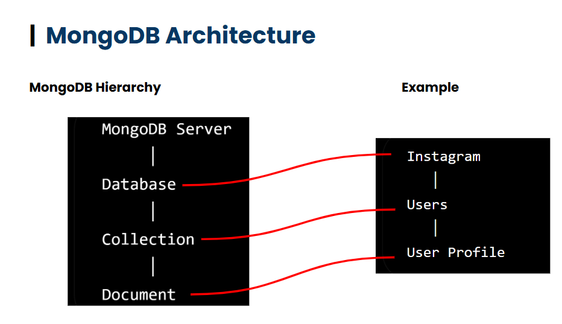
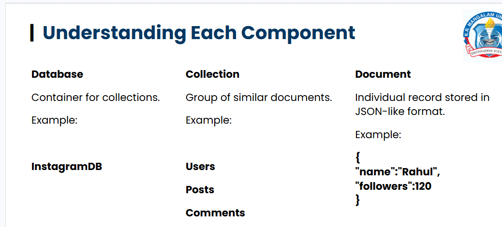

🔄 What is CRUD?
Every database application performs four fundamental operations, collectively known as CRUD:

Letter	Operation	Purpose
C	Create	Add new data
R	Read	Retrieve existing data
U	Update	Modify existing data
D	Delete	Remove unwanted data

markdown
# MongoDB CRUD Practice

Practice repo for MongoDB CRUD operations using `mongosh`.

## Setup

```bash
mongosh
use collageDB
Collections
students — sample student records

CRUD Operations
Create
javascript
db.students.insertOne({ name: "Rahul", course: "BCA", semester: 5 })

db.students.insertMany([
  { name: "Priya", course: "MCA", semester: 3 },
  { name: "Aman", course: "BCA", semester: 1 },
  { name: "Sneha", course: "BBA", semester: 2 }
])
Read
javascript
db.students.find()
db.students.findOne({ name: "Rahul" })
Update
javascript
// single document
db.students.updateOne(
  { name: "Rahul" },
  { $set: { semester: 6 } }
)

// multiple documents
db.students.updateMany(
  { course: "BCA" },
  { $set: { semester: 6 } }
)
Delete
javascript
db.students.deleteOne({ name: "Aman" })
db.students.deleteMany({ course: "BCA" })
Cheat Sheet
Operation	Method	Use
Create	insertOne() / insertMany()	Add document(s)
Read	find() / findOne()	Fetch document(s)
Update	updateOne() / updateMany()	Modify document(s)
Delete	deleteOne() / deleteMany()	Remove document(s)
Notes
use <db> creates the DB lazily — it exists only after data is inserted.

$set updates only the specified field.

_id is auto-generated by MongoDB if not provided.

markdown
# MongoDB Query Operations — Practice Notes

Hands-on practice for **Lecture 22: Query Operations in MongoDB**, using `mongosh` on the `collageDB` database.

---

## Setup

```bash
mongosh
use collageDB
Dataset — students Collection
javascript
db.students.insertMany([
  { name: "Rahul", course: "BCA", semester: 5, age: 21, marks: 82, city: "Delhi" },
  { name: "Priya", course: "MCA", semester: 2, age: 23, marks: 91, city: "Gurugram" },
  { name: "Aman",  course: "BCA", semster: 3,  age: 20, marks: 75, city: "Noida" },
  { name: "Sneha", course: "BCA", semster: 5,  age: 22, marks: 88, city: "Delhi" }
])
Note: Aman and Sneha were inserted with the misspelled field semster instead of semester. This caused several queries on semester to skip those documents.

Read Operations
Retrieve All / One
javascript
db.students.find()
db.students.findOne()
db.students.findOne({ name: "Sneha" })   // returns first match
Filter by Field Value
javascript
db.students.find({ course: "BCA" })
Filter by Multiple Fields (Implicit AND)
javascript
db.students.find({ course: "BCA", semster: 5 })
Comparison Operators
javascript
db.students.find({ marks: { $gt: 80 } })    // marks greater than 80
db.students.find({ age:   { $gte: 21 } })   // age greater than or equal to 21
Operator	Meaning
$gt	Greater than
$gte	Greater than or equal
$lt	Less than
$lte	Less than or equal
$ne	Not equal
Logical Operators
javascript
db.students.find({
  $or: [ { city: "Delhi" }, { marks: { $gt: 90 } } ]
})
Returns documents that match either condition.

Operator	Meaning
$or	Match any condition
$and	Match all conditions (same as comma-separated fields)
$not	Negate a condition
Projection (Select Specific Fields)
javascript
db.students.find({}, { name: 1, marks: 1, _id: 0 })
1 → include the field

0 → exclude the field

_id is included by default unless explicitly set to 0

Sorting, Limit, Skip
javascript
db.students.find().sort({ marks: -1 })   // -1 = descending, 1 = ascending
db.students.find().limit(3)              // first 3 documents
db.students.find().skip(3)               // skip first 3 documents
Combining Everything
javascript
db.students.find(
  { course: "BCA", semester: 5 },
  { name: 1, marks: 1, _id: 0 }
).sort({ marks: -1 })
Result:

json
[ { name: 'Rahul', marks: 82 } ]
javascript
db.students.find(
  { course: "BCA" },
  { name: 1, marks: 1, _id: 0 }
).sort({ marks: -1 })
Result:

json
[
  { name: 'Sneha', marks: 88 },
  { name: 'Rahul', marks: 82 },
  { name: 'Aman',  marks: 75 },
  { name: 'Rahul' }
]
Rahul (the first-inserted doc) has no marks field, so it appears last in descending sort and shows only name in projection.

markdown
# MongoDB Aggregation & Indexing — Practice Notes

Hands-on practice for **Lecture 23: Aggregation Pipeline + Indexing in MongoDB**, using `mongosh` on the `collageDB` database.

---

## 1. Aggregation Pipeline Stages

The aggregation framework processes documents through a multi-stage pipeline.

### `$match` (Filtering)
Filters documents to pass only those matching the specified condition.
```javascript
db.students.aggregate([
  { $match: { course: "BCA" } }
])
$project (Selecting Fields)
Reshapes documents by including or excluding fields (similar to .find() projection).

javascript
db.students.aggregate([
  { $project: { name: 1, marks: 1, _id: 0 } }
])
$group (Aggregating Data)
Groups documents by a specified key (_id) and performs calculations like $sum, $avg, etc.

javascript
db.students.aggregate([
  { 
    $group: { 
      _id: "$course", 
      averageMarks: { $avg: "$marks" }, 
      totalStudents: { $sum: 1 } 
    } 
  }
])
Result Note: Courses with no marks field (like BBA) return null for averageMarks. The $sum: 1 counts every document in the group.

$sort (Ordering)
Sorts documents (1 for ascending, -1 for descending).

javascript
db.students.aggregate([
  { $sort: { marks: -1 } }
])
Result Note: Documents missing the marks field are placed at the bottom when sorting descending.

$limit (Restricting Output)
Limits the number of documents passed to the next stage.

javascript
db.students.aggregate([
  { $limit: 2 }
])
$count (Counting Documents)
Returns a single document containing the total count.

javascript
db.students.aggregate([
  { $count: "TotalStudents" }
])
// Output: [ { TotalStudents: 7 } ]
2. Chaining Pipeline Stages
Stages can be combined to perform complex queries. The output of one stage becomes the input for the next.

javascript
db.students.aggregate([
  { $match: { course: 'BCA' } },
  { $group: { _id: "$semester", averageMarks: { $avg: "$marks" }, totalStudents: { $sum: 1 } } },
  { $sort: { averageMarks: -1 } }
])
What this does:

Filters only BCA students.

Groups them by semester, calculating average marks and counting students.

Sorts the resulting groups by average marks in descending order.

3. Indexing
Indexes improve the speed of read operations by allowing MongoDB to search efficiently without scanning the entire collection.

Create a Single-Field Index
javascript
db.students.createIndex({ rollNo: 1 })
// Output: rollNo_1
Create a Compound Index
javascript
db.students.createIndex({ course: 1, semster: 1 })
// Output: course_1_semster_1
View All Indexes
javascript
db.students.getIndexes()
Output:

json
[
  { v: 2, key: { _id: 1 }, name: '_id_' },
  { v: 2, key: { rollNo: 1 }, name: 'rollNo_1' },
  { v: 2, key: { course: 1, semster: 1 }, name: 'course_1_semster_1' }
]
Note: The _id_ index is created automatically by MongoDB for every collection.

# MongoDB Data Modelling & Relationships — Lecture Notes

## 1. What is Data Modelling?
Planning the database structure **before** storing data.
- Defines what data is stored, how documents are structured, and how collections relate.
- Prevents data duplication, inconsistency, and slow queries.

## 2. Components of a Data Model
- **Database** → Container for collections.
- **Collection** → Group of related documents.
- **Document** → A single record.
- **Field** → An attribute.
- **Relationship** → Connection between documents.

## 3. Types of Relationships
| Type | Example | Description |
| :--- | :--- | :--- |
| **One-to-One (1:1)** | Employee → ID Card | Each record relates to exactly one other. |
| **One-to-Many (1:N)** | Department → Students | One document relates to many. |
| **Many-to-Many (M:N)** | Students ↔ Courses | Multiple records relate to multiple. |

## 4. Why It Matters
- Good design = organized data, minimal redundancy, clear relationships, easier scaling.
- Poor design = duplicates, hard updates, slow queries, complex logic.

markdown
# Mongoose Connection Setup

## 1. Install Mongoose
Run this in your terminal to add Mongoose to your Node.js project:
```bash
npm install mongoose
2. Connect to MongoDB
Instead of using .then() and .catch() (as shown in older tutorials), it is best practice to use async/await with a try/catch block.

Code Implementation (index.js)
javascript
const mongoose = require('mongoose');

async function connectDB() {
  try {
    // Make sure to include your database name (e.g., tour&travel) at the end of the URL
    await mongoose.connect('mongodb://127.0.0.1:27017/tour&travel');
    console.log('MongoDB connected successfully!');
  } catch (err) {
    console.error('MongoDB connection failed:', err.message);
    process.exit(1); // Exit process with failure code
  }
}

connectDB();
3. Verification
To ensure the connection is working and pointing to the right database, open your terminal and run:

bash
mongosh
use tour&travel
db.tours.find()

markdown
# Mongoose Setup: Schemas, Models, and Data Insertion

This guide documents the setup for connecting a Node.js application to MongoDB using **Mongoose**, defining a Schema, and inserting data.

---

## 📂 Project Structure
```text
day_12/
├── model/
│   └── tour.js       # Contains the Schema and Model
├── index.js          # Main entry point (Database connection & execution)
├── package.json
└── node_modules/
1. Installing Mongoose
Run this command in your terminal to install Mongoose in your project:

bash
npm install mongoose
2. Defining a Schema and Model (model/tour.js)
Mongoose uses Schemas to enforce data structure, and Models to interact with the database.

Create a file tour.js inside the model folder:

javascript
const mongoose = require('mongoose');

// 1. Define the Schema (The blueprint)
const tourSchema = new mongoose.Schema({
    name: {
        type: String,
        required: [true, 'A tour must have a name']
    },
    description: {
        type: String
    },
    destination: {
        type: String,
        required: true
    },
    duration: {
        type: String
    }
});

// 2. Create the Model
const Tour = mongoose.model('Tour', tourSchema);

// 3. Export the Model so it can be used in other files
module.exports = Tour;
Note: Mongoose automatically pluralizes the model name. Tour becomes the tours collection in MongoDB.

3. Connecting and Saving Data (index.js)
Use async/await to connect to the database, and wait for the connection to succeed before attempting to insert data.

javascript
const mongoose = require('mongoose');

// Import the Tour model from the model folder
const Tour = require('./model/tour'); 

async function connectDB() {
    try {
        // Connect to the local MongoDB database named 'tour&travel'
        await mongoose.connect('mongodb://127.0.0.1:27017/tour&travel');
        console.log('MongoDB connected successfully!');
        
        // Call createTour ONLY AFTER the connection is successful
        await createTour(); 

    } catch (err) {
        console.error('MongoDB connection failed:', err.message);
        process.exit(1);
    }
}

async function createTour() {
    try {
        // Create a new document using the Schema rules
        const newTour = await Tour.create({
            name: "Mountain Hiking",
            description: "Explore the beautiful mountains.",
            destination: "Manali",
            duration: "5 days"
        });
        console.log("Tour saved successfully:", newTour);
    } catch (error) {
        console.log("Error saving tour:", error.message);
    }
}

// Run the connection
connectDB();
4. Execution & Verification
Run the script
bash
node index.js
Expected Output
text
MongoDB connected successfully!
Tour saved successfully: {
  name: 'Mountain Hiking',
  description: 'Explore the beautiful mountains.',
  destination: 'Manali',
  duration: '5 days',
  _id: new ObjectId('...'),
  __v: 0
}
Verify in MongoDB Shell (mongosh)
Open a new terminal and check the database:

bash
mongosh
use tour&travel
db.tours.find()